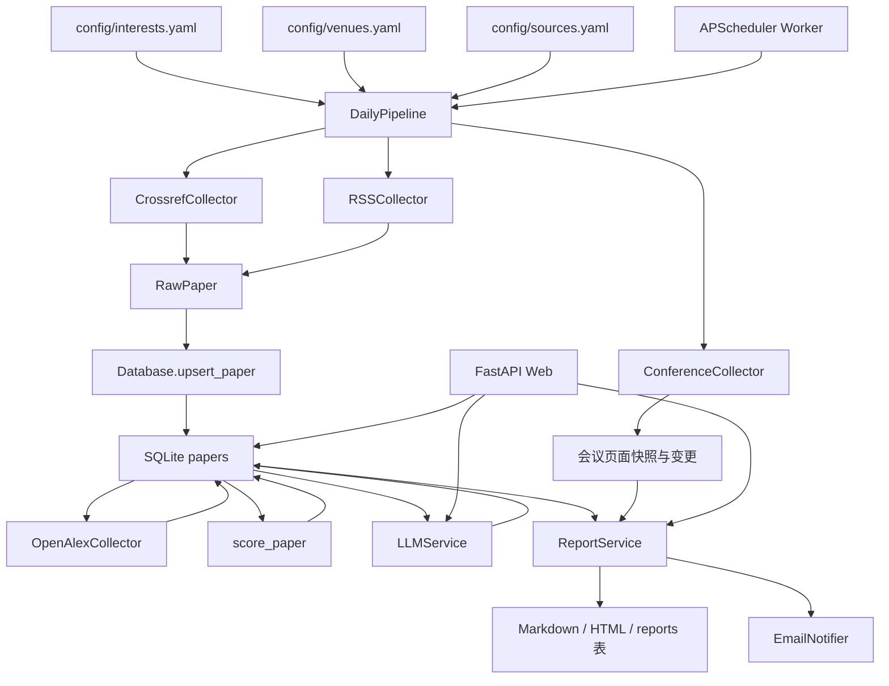

# 项目结构与 AI 改造指南

本文面向准备复用“科研雷达”、更换研究领域，或者让 AI 协助修改代码的同学。

目标不是介绍所有实现细节，而是说明：

- 系统由哪些部分组成。
- 一篇论文从采集到进入报告的完整路径。
- 更换研究方向时，哪些内容只需改配置，哪些必须改代码。
- 新增期刊、会议或论文数据源时应该修改哪些文件。
- 如何向 AI 描述需求，才能降低改坏认证、加密、数据库和部署逻辑的风险。
- 修改完成后如何验证。

## 1. 项目定位

这是一个“来源优先”的科研信息聚合系统。它不要求用户每天手工浏览 arXiv，而是：

1. 按 ISSN 从 Crossref 获取指定期刊的新论文元数据。
2. 从出版社 RSS 补充期刊动态。
3. 使用 OpenAlex 补全摘要、引用和开放获取信息。
4. 监测会议主页、技术程序或征稿页面的变化。
5. 根据期刊层级、关键词相关性、引用速度、新颖性、开放程度和人工反馈排序。
6. 调用 OpenAI 兼容的 Chat Completions 接口生成中文结构化总结。
7. 生成 Markdown、HTML 日报和周报，可选通过 SMTP 发送邮件。

当前默认方向是气动声学、计算声学和流体力学，但采集、存储、报告和网页框架本身可以复用于其他学科。

## 2. 总体架构



系统有两个长期运行的容器或进程：

- `web`：FastAPI 网页、管理员设置、论文查询、手动更新 AI 总结。
- `worker`：APScheduler 定时执行每日采集和周报任务。

两者共享 SQLite 数据目录和 `secrets` 目录。SQLite 使用 WAL 模式，适合单机低并发部署，不适合把同一数据库挂载给多台机器同时写入。

## 3. 目录与模块职责

| 路径 | 职责 | 修改频率 |
| --- | --- | --- |
| `config/interests.yaml` | 研究方向、主题分组、关键词权重、排除词 | 更换方向时必改 |
| `config/venues.yaml` | 重点期刊、ISSN、RSS、会议页面 | 更换方向时必改 |
| `config/sources.yaml` | 回看天数、单期刊条数、请求间隔、增强上限 | 按采集规模修改 |
| `app/pipeline.py` | 串联采集、去重、增强、评分、总结、会议和报告 | 流程变化时修改 |
| `app/sources/` | 各外部数据源采集器 | 新增来源时扩展 |
| `app/domain.py` | 采集器与数据库之间的统一数据结构 `RawPaper` | 新增标准字段时修改 |
| `app/db.py` | SQLite 读写、去重、状态、报告和设置 | 数据模型变化时修改 |
| `app/schema.sql` | 新数据库表结构 | 新增字段或表时修改 |
| `app/scoring.py` | 论文热度与相关性评分 | 调整排序逻辑时修改 |
| `app/llm.py` | AI 提示词、接口调用、JSON 解析、错误脱敏 | 调整总结内容时修改 |
| `app/reporting.py` | 日报、周报分组和 Markdown/HTML 生成 | 调整报告结构时修改 |
| `app/notify.py` | SMTP 邮件发送 | 邮件行为变化时修改 |
| `app/scheduler.py` | 每日、每周定时任务 | 调度逻辑变化时修改 |
| `app/main.py` | FastAPI 路由、登录、设置、反馈、手动总结 | 页面和接口变化时修改 |
| `app/auth.py` | 密码哈希、签名会话、CSRF | 谨慎修改 |
| `app/crypto.py` | API Key 加密、密钥和自签名证书 | 谨慎修改 |
| `app/config.py` | 环境变量、YAML 模型和数据库设置合并 | 新增运行参数时修改 |
| `app/templates/` | Jinja2 页面 | 界面变化时修改 |
| `app/static/style.css` | 页面样式 | 界面变化时修改 |
| `tests/` | 单元和接口测试 | 行为变化时必须补充 |
| `Dockerfile` | 镜像构建 | 依赖或系统包变化时修改 |
| `docker-compose.yml` | 单文件部署参数 | 部署参数变化时修改 |
| `.github/workflows/ci.yml` | 测试、构建和发布 GHCR 镜像 | CI/CD 变化时修改 |

## 4. 一次每日任务的数据流

入口有两类：

```sh
# 容器中的定时任务
python -m app.cli scheduler

# 手工立即执行
python -m app.cli run-daily
```

`DailyPipeline.run()` 的顺序如下：

1. 读取 `interests.yaml`、`venues.yaml`、`sources.yaml`。
2. 将期刊和会议登记到 `venues` 表。
3. 并行执行 Crossref 和 RSS 期刊采集。
4. 将采集结果转换为统一的 `RawPaper`。
5. 按 DOI 优先、标题加期刊作为回退键去重并写入 `papers`。
6. 选择最近 30 天、最多 500 篇中的 DOI 论文，交给 OpenAlex 补全。
7. 根据配置文件、引用数据、开放获取状态和人工反馈计算分数。
8. 从最近 14 天、最多 200 篇中固定取出分数最高的前 N 篇，执行 AI 总结。
9. 使用 AI 返回的新颖度重新评分。
10. 检查会议页面是否发生变化。
11. 生成日报并保存到数据库和文件。
12. 可选发送邮件。
13. 将任务状态、统计和错误写入 `job_runs`。

需要特别注意：

- Crossref 和 RSS 当前只遍历 `journals`，不直接为会议创建论文记录。
- 会议采集目前是“页面变化监测”，不是会议论文采集器。
- OpenAlex 默认只增强最近 30 天中的前 50 个 DOI。
- 批量 AI 总结只处理前 N 篇中尚未完成的论文，不会跳过前 N 篇后继续顺延。
- 手动“更新 AI 总结”可以覆盖已有总结，但需要管理员登录和有效 CSRF。
- 日报默认取最近 30 小时首次出现的论文，周报默认取最近 7 天论文。

## 5. 核心数据结构

### 5.1 RawPaper

每个采集器都应返回 `app/domain.py` 中的 `RawPaper`。最重要的字段：

| 字段 | 含义 |
| --- | --- |
| `source` | 来源名称，例如 `crossref`、`rss`、`openalex` |
| `source_id` | 来源内稳定 ID，通常使用 DOI |
| `title` | 原始标题 |
| `abstract` | 原始摘要，未清洗或缺失时可为空 |
| `doi` | DOI，不带 `https://doi.org/` 前缀 |
| `venue_slug` | 对应 `venues.yaml` 的稳定 slug |
| `venue_name` | 来源显示名称 |
| `venue_kind` | 当前为 `journal` 或 `conference` |
| `published_date` | 正式发表日期 |
| `online_date` | 在线发表日期 |
| `url` / `pdf_url` | 详情页和开放 PDF 地址 |
| `is_oa` | 是否开放获取 |
| `cited_by_count` | 引用数 |
| `metadata` | 来源特有但不进入标准字段的附加信息 |

如果新来源能映射到这些字段，优先复用现有数据库和页面，不要新建一套论文表。

### 5.2 数据库主要表

| 表 | 用途 |
| --- | --- |
| `venues` | 期刊和会议登记 |
| `papers` | 论文元数据、评分、AI 总结和状态 |
| `paper_sources` | 同一论文来自哪些采集源 |
| `citation_snapshots` | 每日引用数快照 |
| `feedback` | 用户对论文的“重要/忽略”反馈 |
| `conference_sources` | 会议页面最近快照、ETag 和内容哈希 |
| `conference_updates` | 检测到的会议页面变化 |
| `reports` | 日报和周报内容及文件路径 |
| `job_runs` | 任务状态、统计和错误 |
| `app_settings` | 网页配置，其中敏感值加密后存储 |
| `app_users` | 管理员用户名和密码哈希 |

论文去重规则：

- 有 DOI 时使用 `doi:<小写 DOI>`。
- 无 DOI 时使用标题归一化结果加 `venue_slug`。
- 合并时优先保留非空摘要、作者、日期和链接，不覆盖已有的完整 AI 总结。

## 6. 配置驱动与代码驱动的边界

### 6.1 只修改 YAML 就能完成的情况

以下需求通常只需要修改配置：

- 从气动声学改为燃烧、结构健康监测、机器人、材料计算等其他方向。
- 增减关键词和主题分组。
- 调整主题权重。
- 增加或删除期刊。
- 增加出版社 RSS。
- 增加需要监测的会议页面。
- 调整采集回看天数、请求频率和单期刊条数。

### 6.2 需要同时修改代码的情况

以下需求不能只改关键词：

- 新来源不是 Crossref、RSS 或普通网页，例如 Semantic Scholar、Scopus、学校自建接口。
- 需要采集会议论文列表并作为论文入库，而不是仅检测网页变化。
- 需要新增“研究机构”“数据集”“专利”等数据模型。
- 需要改变评分公式或排序权重。
- 需要让 AI 输出不同于当前八个字段的结构。
- 需要把报告分组从固定三类改成动态主题。
- 需要在网页增加新的筛选条件、配置项或管理功能。

## 7. 更换研究方向的推荐步骤

### 第一步：先改兴趣画像

编辑 `config/interests.yaml`：

```yaml
profile:
  title: 你的研究方向
  description: 一句话描述关注的问题和方法。
  language: zh-CN

groups:
  - label: 主题一
    weight: 1.0
    keywords:
      - keyword one
      - keyword two

  - label: 主题二
    weight: 0.9
    keywords:
      - another keyword

negative_keywords:
  - erratum
  - correction
  - retraction
  - editorial
```

注意事项：

- `label` 会写入论文标签，并被报告页面用于分组。
- `weight` 参与相关性评分，不是百分比。
- 关键词先统一转小写再做子串匹配。优先使用含义稳定的英文词组。
- 过于宽泛的词会产生大量误报，例如 `model`、`analysis`、`design`。
- `profile.title` 和 `profile.description` 当前主要用于配置说明，不会自动改写首页大标题。

### 第二步：替换重点期刊

在 `config/venues.yaml` 中修改 `journals`。Crossref 采集至少需要一个 ISSN：

```yaml
journals:
  - slug: unique-journal-slug
    name: Full Journal Name
    kind: journal
    tier: 1
    publisher: Publisher Name
    issns: [1234-5678]
    homepage: https://example.com/journal
    rss:
      - https://example.com/journal/rss
    topics: [主题一, 主题二]
```

要求：

- `slug` 必须全局唯一且长期稳定，修改后会被视为新来源。
- `tier` 当前支持 1、2、3，分别影响期刊层级分。
- 有 RSS 时填写 `rss`；没有 RSS 时保留空数组。
- 出版社 RSS 可能只提供目录信息而没有摘要，系统会保留元数据并将状态标为 `metadata_only`。

### 第三步：替换会议监测页面

```yaml
conferences:
  - slug: unique-conference-slug
    name: Conference Name
    kind: conference
    tier: 1
    publisher: Organizer
    homepage: https://conference.example.com/
    topics: [主题一]
    pages:
      - label: 会议主页
        type: homepage
        url: https://conference.example.com/
      - label: 技术程序
        type: program
        url: https://conference.example.com/program
      - label: 征稿通知
        type: call-for-papers
        url: https://conference.example.com/cfp
```

会议页面适合监测：

- 征稿截止日期。
- 技术程序或论文列表。
- 大会报告和特邀报告。
- 会议日期、地点和注册信息变化。

如果网站依赖 JavaScript 动态加载，当前静态 HTML/PDF 采集器可能看不到正文。此时需要新增浏览器渲染来源，不能只改 YAML。

### 第四步：调整采集规模

编辑 `config/sources.yaml`：

| 配置 | 作用 | 调大后的代价 |
| --- | --- | --- |
| `crossref.lookback_days` | Crossref 回看天数 | 请求数增加，首次采集论文更多 |
| `crossref.rows_per_journal` | 每个期刊最多返回条数 | 响应更慢，数据库增长更快 |
| `rss.max_entries_per_feed` | 每个 RSS 最多读取条数 | 更多重复项和无效元数据 |
| `openalex.enrich_limit` | 每次最多增强的 DOI 数 | API 用量和耗时增加 |
| `openalex.batch_size` | OpenAlex 批次大小 | 单次请求过大会触发限制 |
| 各类 `request_delay_seconds` | 请求间隔 | 调小会增加被限流或封禁风险 |

不要在短时间内把这些值同时调得很大。优先保持礼貌请求频率。

### 第五步：修改 AI 角色和输出字段

AI 的系统提示词位于 `app/llm.py` 的 `SYSTEM_PROMPT`。

当前字段：

- `title_zh`
- `problem`
- `method`
- `key_results`
- `limitations`
- `relevance`
- `read_reason`
- `novelty_score`

如果只更换学科，保留字段结构、修改角色描述和 `relevance` 的解释最安全。

如果新增大段字段，例如“实验设备”“数值格式”“数据集”，需要同步修改：

1. `SYSTEM_PROMPT` 的输出 JSON。
2. `app/schema.sql` 的 `papers` 表。
3. `app/db.py` 的 `save_summary()`。
4. 论文详情模板 `app/templates/paper_detail.html`。
5. 报告模板和 `app/reporting.py`。
6. 测试。

数据库迁移注意：

- `schema.sql` 中的 `CREATE TABLE IF NOT EXISTS` 不会给已有表自动增加列。
- 只修改 `schema.sql` 后，新部署可以工作，但旧数据库不会获得新字段。
- 生产环境升级必须写幂等迁移逻辑，例如检查 `PRAGMA table_info(papers)` 后执行 `ALTER TABLE`。
- 本地测试可以先备份或删除测试数据库，但不能把“删库重建”作为生产升级方案。

### 第六步：修改报告分组和页面文案

报告目前固定分为：

- 气动声学
- 流体力学
- 计算方法

对应位置：

- `app/reporting.py` 中的 `sections`。
- `app/templates/report_body.html` 中依赖 `sections` 的展示。
- `app/templates/dashboard.html` 的首页标题和副标题。
- `app/static/style.css` 中可选的领域视觉文案。

更换方向时，推荐保留报告标题为“科研雷达”，只调整领域分组，减少无必要的结构性改动。

## 8. 新增论文来源

### 8.1 适合抽象成采集器的条件

新来源应满足：

- 有稳定的公开接口、RSS 或可解析网页。
- 能提供标题、来源和稳定链接。
- 最好能提供 DOI、摘要和日期。
- 访问频率和许可允许程序化获取。

不要绕过登录、付费墙、验证码、CARSI/Shibboleth 或学校访问控制。

### 8.2 推荐实现方式

在 `app/sources/` 新建模块，例如 `semantic_scholar.py`，提供一个与现有采集器相似的异步接口：

```python
class CustomCollector:
    def __init__(self, settings, policy, http_options):
        ...

    async def collect(self, venues) -> CollectionResult:
        result = CollectionResult()
        # 请求来源，处理限流和异常。
        # 将每条记录转换为 RawPaper。
        result.papers.append(paper)
        result.stats["custom_records"] = len(result.papers)
        return result
```

接入步骤：

1. 将来源特有字段映射到 `RawPaper`。
2. 复用 `app.sources.http.request_with_retry()` 的限流和重试。
3. 清理标题、摘要和 DOI，避免把 HTML 写入数据库。
4. 在 `DailyPipeline.run()` 中调用采集器。
5. 将采集器错误加入 `errors`，不要让单个来源失败阻断整个任务。
6. 将统计加入 `stats`，便于网页显示排障信息。
7. 为解析逻辑添加不依赖真实网络的测试数据。
8. 更新 `README.md` 和本指南中的来源说明。

### 8.3 不建议的做法

- 不要为每个来源复制 `papers` 表。
- 不要在网页请求线程中直接执行长时间抓取。
- 不要把 API Key 拼接到会被日志打印的 URL。
- 不要直接把外部 HTML 用 `|safe` 输出到模板。
- 不要忽略来源服务的使用条款、robots 约束和速率限制。

## 9. 评分逻辑

当前最终分数：

```text
final =
    0.25 * venue
  + 0.25 * relevance
  + 0.20 * momentum
  + 0.15 * novelty
  + 0.10 * openness
  + 0.05 * feedback
```

解释：

- `venue`：期刊或会议层级。
- `relevance`：兴趣关键词命中组权重。
- `momentum`：按论文年龄归一化后的引用速度，新论文不会被零引用直接判低。
- `novelty`：AI 给出的新颖度，默认 0.5。
- `openness`：是否开放获取。
- `feedback`：用户“重要/忽略”反馈映射。

修改评分时至少检查：

- 所有分项是否仍为 0 到 1。
- 权重和是否仍为 1，或明确接受新的量纲。
- 新论文是否因零引用被错误惩罚。
- 反馈是否会让单篇论文无限重复置顶。
- `tests/test_scoring.py` 是否仍覆盖边界情况。

## 10. AI 总结行为

批量总结的固定规则：

1. 从最近 14 天、最多 200 篇中按现有排序取前 N 篇。
2. 只处理其中 `summary_status != "complete"` 的论文。
3. 前 N 篇中已完成或摘要不足的论文会跳过。
4. 不会因为跳过了前 N 篇中的论文而继续顺延总结第 N 篇之后的论文。

手动总结：

- 首页和详情页都有入口。
- 仅管理员可执行。
- 有 CSRF 校验。
- 可以覆盖已有完整总结。
- 调用或解析失败时不会删除旧总结。

如果需要“每日重新总结全部论文”，必须明确修改当前“已完成跳过”逻辑，并考虑 API 成本、调用频率和覆盖策略。不要只把 `summary_limit` 调大来模拟该行为。

## 11. 运行参数与敏感信息

### 11.1 Compose 环境变量

适合放在 `docker-compose.yml` 的参数：

- 应用名称、监听地址、端口和时区。
- TLS 是否启用、证书包含哪些主机名。
- 会话有效期和 Cookie 是否仅限 HTTPS。
- Crossref 联系邮箱、OpenAlex `mailto` 和 User-Agent。
- 每日、每周运行时间。
- 出网代理。

这些值会以明文出现在 Compose 文件、`docker inspect` 和部分日志中。不要在这里填写 API Key、SMTP 密码或管理员密码。

### 11.2 网页保存到数据库的参数

登录后在“系统设置”中配置：

- OpenAlex API Key。
- 学校 OpenURL。
- LLM 地址、模型、Key 和单次总结数量。
- SMTP 主机、账号、密码和收件人。
- 管理员密码。

其中 `openalex_api_key`、`llm_api_key`、`smtp_password` 使用 Fernet 认证加密后写入 SQLite。

`radar-data` 和 `radar-secrets` 必须一起备份。只有数据库而没有设置加密密钥时，敏感设置无法解密；只有密钥而没有数据库也无法恢复业务数据。

### 11.3 进程读取配置的时机

- 网页中保存的数据库设置会在下一次任务或下一次请求时重新读取。
- Compose 环境变量在容器启动时读取。
- 修改运行时间、端口、TLS 主机名或代理后，需要重新创建相应容器。
- 修改 LLM、SMTP、OpenAlex Key 和 OpenURL 后不需要重启。

## 12. 安全边界

让 AI 修改项目时，以下约束应作为硬性要求写进任务：

- 不把 API Key、密码、Cookie、初始化令牌写入源码、Compose、日志或测试快照。
- 不记录 `Authorization` 请求头、完整提示词或带凭据 URL。
- 不关闭已有登录、CSRF、密码哈希和敏感设置加密。
- 配置 API Key 时，LLM 接口必须使用 HTTPS。
- SMTP 必须使用 SSL 或 STARTTLS，并校验证书。
- 外部 URL 必须限制为 `http` 或 `https`，不能包含用户名和密码。
- 模板中的外部文本默认转义，不使用 `|safe` 渲染不可信内容。
- 不绕过出版社付费墙、验证码或学校登录。
- 内网 HTTP 仅用于隔离调试。正式校园网部署应保留 HTTPS，并只允许可信网段访问。

## 13. 给 AI 的改造提示词模板

复制下面的模板，再补充自己的方向、期刊和验收标准：

```text
请修改这个科研雷达项目，把研究领域从“气动声学、计算声学与流体力学”
改为“<你的方向>”。

开始前：
1. 先阅读 docs/AI_MODIFICATION_GUIDE.md、README.md、config/ 和 app/pipeline.py。
2. 先列出你认为需要修改的文件和原因，再执行修改。
3. 不要删除或弱化登录、CSRF、密码哈希、敏感设置加密、HTTPS 和 SMTP TLS。
4. 不要在源码、测试、日志或 docker-compose.yml 中写入真实 API Key 或密码。

功能要求：
- 新方向是：<研究方向>。
- 重点关注主题：<主题 1>、<主题 2>、<主题 3>。
- 重点期刊和 ISSN：
  <期刊名> / <ISSN>
  <期刊名> / <ISSN>
- 重点会议和公开页面：
  <会议名> / <主页或 program URL>
- AI 总结继续使用中文结构化输出。
- 报告分组改为：<分组 1>、<分组 2>、<分组 3>。

实现要求：
- 能用配置表达的，优先改 config/*.yaml。
- 如果新增数据库字段，必须为已有数据库提供幂等迁移，不能只改 schema.sql。
- 如果新增外部来源，使用 RawPaper 和 CollectionResult，
  复用 request_with_retry，并处理限流、超时和脱敏。
- 修改模板时保持移动端可读和现有交互一致性。

测试要求：
- 更新或新增相关测试。
- 运行 uv run pytest -q。
- 运行 uv run ruff check .
- 运行 git diff --check。
- 最后总结修改内容、迁移影响、剩余风险和部署是否需要重建容器。
```

如果只是换关键词和期刊，可以使用更短的提示词：

```text
请只修改 config/interests.yaml、config/venues.yaml 和相关文档，把研究领域改为
“<方向>”。然后检查所有测试中是否仍硬编码旧领域。不要修改认证、加密、
数据库结构或部署方式。完成后运行 pytest 和 Ruff。
```

## 14. 常见改造场景与修改位置

| 需求 | 主要修改位置 |
| --- | --- |
| 换关键词和主题 | `config/interests.yaml`、`app/llm.py`、报告文案、测试 |
| 增加期刊 | `config/venues.yaml`、可能的 `tests/test_scoring.py` |
| 增加 RSS | `config/venues.yaml` |
| 增加会议页面 | `config/venues.yaml` |
| 会议论文入库 | 新增 collector、`RawPaper`、`pipeline.py`、测试 |
| 调整排序 | `app/scoring.py`、`tests/test_scoring.py` |
| 修改 AI 总结字段 | `app/llm.py`、`schema.sql`、`db.py`、模板、报告、测试 |
| 增加网页设置 | `config.py`、`main.py`、`settings.html`；敏感字段还要改 `crypto.py` |
| 动态报告分组 | `reporting.py`、`report_body.html`、相关测试 |
| 调整定时任务 | `scheduler.py`、`config.py`、`docker-compose.yml` |
| 新增邮件渠道 | `notify.py`、`reporting.py`、配置页面、测试 |
| 更换数据库 | `db.py`、`schema.sql`，并重新设计并发和备份策略 |
| 多用户或权限 | `auth.py`、`main.py`、`schema.sql`、所有管理路由和测试 |

## 15. 本地开发与验证

项目使用 Python 3.12 和 `uv`。

Windows PowerShell：

```powershell
$env:UV_CACHE_DIR=(Join-Path (Get-Location) '.uv-cache')
$env:UV_PYTHON_INSTALL_DIR=(Join-Path (Get-Location) '.python')
$env:PYTHONUTF8='1'
uv sync --frozen
uv run python -m app.cli init-db
uv run pytest -q
uv run ruff check .
git diff --check
```

本地启动：

```powershell
uv run python -m app.run
```

首次访问：

```text
https://127.0.0.1:8443/setup
```

不调用真实外网采集器时，可以先插入演示数据：

```powershell
uv run python -m app.cli seed-demo
```

执行一次完整采集：

```powershell
uv run python -m app.cli run-daily
```

只生成报告：

```powershell
uv run python -m app.cli report-daily
uv run python -m app.cli report-weekly
```

## 16. 测试地图

| 测试文件 | 主要覆盖内容 |
| --- | --- |
| `test_auth.py` | 密码、会话和 CSRF |
| `test_database.py` | 论文去重、设置和数据库行为 |
| `test_normalize.py` | DOI、标题、日期和文本清洗 |
| `test_scoring.py` | 相关性、期刊分层和引用热度 |
| `test_llm.py` | AI 接口路径、兼容重试和错误脱敏 |
| `test_pipeline.py` | 前 N 篇总结边界 |
| `test_summary_actions.py` | 手动总结按钮、权限、覆盖和失败保留 |
| `test_conference.py` | 会议页面条件请求和 304 响应 |
| `test_reporting.py` | 日报文件生成 |
| `test_notify.py` | 邮件安全约束 |
| `test_settings.py` | 网页设置校验 |
| `test_http.py` | 请求重试和限流 |

新增真实来源时，还要在测试中使用固定 JSON、HTML 或 PDF fixture 模拟响应，不能让测试依赖当天网页内容。

## 17. 数据库升级检查清单

修改 `schema.sql` 前先回答：

1. 这是新表、新索引，还是已有表新增列？
2. 已有用户的数据库如何获得新列？
3. 默认值是否安全？
4. 旧数据无法填写新字段时页面能否正常显示？
5. 回滚代码时数据库是否仍兼容？
6. 备份恢复是否仍包含 `radar-data` 和 `radar-secrets`？

当前项目没有独立迁移框架。新表通常可由 `CREATE TABLE IF NOT EXISTS` 创建，但已有表增加列必须写显式迁移。

## 18. 部署变化判断

只修改 YAML、Python 业务代码或模板：

```sh
docker compose build
docker compose up -d
```

使用公开发布镜像的软路由部署：

```sh
docker compose pull
docker compose up -d
```

修改 Compose 环境变量后：

```sh
docker compose up -d --force-recreate
```

修改 `Dockerfile`、依赖或启动命令后必须重新构建镜像。GitHub Actions 在 `main` 分支更新后会自动构建 GHCR 镜像。

## 19. 提交前检查清单

- [ ] 研究方向、关键词和负向关键词已更新。
- [ ] 期刊 ISSN 与 RSS 地址可用。
- [ ] 会议页面是公开页面，没有绕过登录。
- [ ] AI 提示词不再引用旧领域。
- [ ] 报告固定分组已同步更新。
- [ ] 新增字段有数据库迁移。
- [ ] 新来源复用重试、超时和错误隔离。
- [ ] 没有提交 `.env`、数据库、证书、密钥或真实凭据。
- [ ] 日志和错误信息已脱敏。
- [ ] 登录、CSRF、HTTPS 和加密逻辑没有被弱化。
- [ ] `uv run pytest -q` 通过。
- [ ] `uv run ruff check .` 通过。
- [ ] `git diff --check` 通过。
- [ ] README 或本指南已同步更新。

## 20. 推荐的改造顺序

为了降低风险，建议按以下顺序进行：

1. 只改 `interests.yaml` 和 `venues.yaml`。
2. 用 `seed-demo` 检查页面和报告。
3. 跑一次小规模真实采集，观察日志和误报。
4. 调整关键词、期刊层级和采集时间窗口。
5. 再修改 AI 提示词和报告分组。
6. 确有必要时再改数据库结构和新增来源。
7. 最后更新 Docker、CI 和部署文档。

这样可以先验证“研究方向是否正确”，再投入时间处理数据源和工程扩展。
